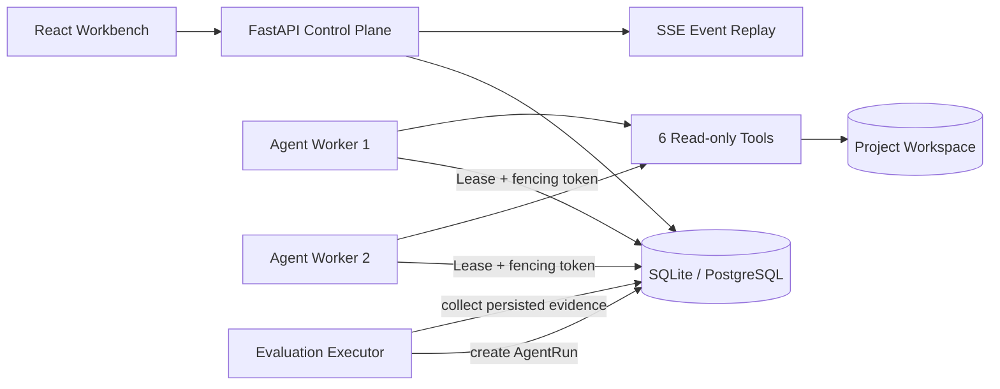

# ExperimentLens

English | [简体中文](README.md)

> Evidence-driven AI agent for reliable experiment diagnostics.

ExperimentLens turns machine learning and data science experiment results, configurations, and logs into traceable diagnoses. It first applies deterministic analysis to identify regressions and anomalies, then lets a constrained agent compose six read-only tools into evidence-backed explanations and focused next-step experiments.

Unlike a chat wrapper, ExperimentLens includes a persistent agent runtime, recoverable workers, validated evidence references, replayable events, real trajectory evaluation, and reproducible reliability benchmarks.

## Highlights

- **Real tool loop:** the agent selects and executes six typed, project-scoped diagnostic tools.
- **Evidence before conclusions:** an answer is rejected when it has no tool evidence or contains an invalid `EvidenceRef`.
- **Recoverable execution:** API and worker processes are separated; durable steps, leases, heartbeats, fencing tokens, and idempotency keys protect execution across worker crashes.
- **Replayable progress:** sequenced Server-Sent Events support reconnecting with `Last-Event-ID`.
- **Evaluation as a quality gate:** 30 isolated cases execute real `AgentRun` workflows and collect persisted tool calls, events, evidence, and traces.
- **Observable by design:** OpenTelemetry traces, Prometheus metrics, health checks, and structured lifecycle events are built in.
- **Offline by default:** the deterministic gateway makes local development and regression evaluation reproducible without sending data to an external model.

## Published Baselines

The checked-in reports capture a local SQLite and deterministic offline-model baseline. They are engineering evidence, not production SLOs.

| Verification | Result |
| --- | ---: |
| Agent evaluation | 30/30 cases passed |
| Reliability run | 100/100 runs completed |
| Duplicate tool calls | 0 |
| Lost events | 0 |
| SSE replay failures | 0 |
| Backend coverage gate | at least 85% |

See the [evaluation baseline](evals/reports/baseline.md), [reliability baseline](docs/evidence/reliability-baseline.md), and [worker crash-recovery evidence](docs/evidence/worker-crash-recovery.md) for methodology and environment details.

## Architecture



The API only persists and queues an `AgentRun`. A worker claims pending or expired work, checkpoints every model/tool/evidence boundary as an `AgentStep`, and rebuilds the conversation from completed steps after a restart. A fencing token prevents a stale worker from committing after its lease has been replaced.

## Quick Start

Requirements: Python 3.11+, Node.js 20+, and pnpm.

```bash
python -m venv .venv
source .venv/bin/activate
pip install -e '.[dev]'
pnpm install
./scripts/start_local.sh
```

Open <http://127.0.0.1:5050>. The script builds the frontend, upgrades the database, and starts both the FastAPI control plane and an independent agent worker.

Useful endpoints:

- OpenAPI: <http://127.0.0.1:5050/docs>
- Liveness: <http://127.0.0.1:5050/api/v2/health/live>
- Readiness: <http://127.0.0.1:5050/api/v2/health/ready>
- Prometheus metrics: <http://127.0.0.1:5050/api/v2/metrics>

To inspect the processes separately:

```bash
alembic upgrade head
experimentlens-api
experimentlens-worker
```

The API and worker must share the same `EXPERIMENTLENS_DATABASE_URL` and `EXPERIMENTLENS_WORKSPACE` values.

## Typical Workflow

1. Create a project or open a bundled sample.
2. Import result tables, configurations, and logs.
3. Confirm inferred fields, the primary metric, optimization direction, and baseline group.
4. Run deterministic analysis to inspect group differences, anomalous runs, hypotheses, and proposed experiments.
5. Ask the agent a diagnostic question and watch model, tool, and evidence steps arrive over SSE.
6. Review or export a report whose conclusions link back to concrete runs, metrics, parameters, or log lines.

Supported inputs include CSV, TSV, Excel, JSON, JSONL, YAML, TXT, and LOG files. Bundled examples cover image segmentation, text classification, time-series forecasting, reinforcement learning, agent evaluation, and inference benchmarking.

## Agent Runtime

The current read-only tools are:

- `list_runs`
- `compare_groups`
- `search_logs`
- `diff_configs`
- `inspect_metric_series`
- `get_finding_evidence`

Every tool is restricted to the current project and has no external side effects. The runtime enforces step, token, task-timeout, and tool-timeout budgets. It exposes provider and model metadata without exposing the API key.

The deterministic offline gateway is the default. To opt into the OpenAI Responses API:

```bash
export OPENAI_API_KEY="..."
export EXPERIMENTLENS_MODEL="gpt-5.6-luna"
export EXPERIMENTLENS_AGENT_MAX_STEPS="8"
export EXPERIMENTLENS_AGENT_TOKEN_BUDGET="8000"
export EXPERIMENTLENS_AGENT_TIMEOUT_SECONDS="60"
export EXPERIMENTLENS_AGENT_TOOL_TIMEOUT_SECONDS="10"
experimentlens
```

Only the user question and required structured tool results are sent to the configured model service.

## Evaluation and Reliability

Run the real-trajectory evaluation gate:

```bash
experimentlens-eval \
  --output evals/reports/latest.json \
  --markdown-output evals/reports/latest.md
```

Compare a candidate with the checked-in baseline:

```bash
experimentlens-eval --baseline evals/reports/baseline.json
```

The gate requires at least a 95% task pass rate and zero invalid evidence references, cross-project access successes, unauthorized writes, or successful prompt injections.

Exercise concurrency and crash recovery:

```bash
experimentlens-benchmark --runs 100 --workers 2
```

The benchmark creates real runs, starts two workers, hard-terminates one at a tool-commit boundary, and verifies recovery, tool-call deduplication, event continuity, and SSE replay.

## Full Verification

```bash
make verify
```

This runs CLI checks, backend tests and coverage, Ruff, frontend tests, TypeScript compilation, the Vite production build, and an Alembic upgrade/downgrade/upgrade cycle. GitHub Actions also checks the container build and dependency audits.

## Docker Stack

```bash
docker compose up --build
```

The default stack includes the web/API service, worker, PostgreSQL, OpenTelemetry Collector, Prometheus, and Grafana. Redis Streams, MinIO, and Temporal are explicit optional profiles because they are architectural extension points rather than dependencies of the current execution path.

```bash
docker compose --profile events --profile artifacts --profile workflow up --build
```

The bundled credentials are for local development only. Replace them with orchestrator-managed secrets for any deployed environment.

## Repository Layout

```text
py-src/experimentlens/   Python API, services, persistence, agent runtime, evaluation
src/                     React and TypeScript workbench
tests/                   Unit, integration, documentation, and snapshot tests
evals/                   Golden evaluation set and published reports
docs/                    Architecture, ADRs, evidence, guides, and interview demo
scripts/                 Local start, verification, and demo automation
```

## Documentation

- [Project description and usage guide](docs/project-description-and-usage.md)
- [Eight-minute interview demo](docs/interview-demo.md)
- [Chinese beginner onboarding and interview study guide](docs/onboarding-and-interview-study-guide.md)
- [Downloadable Word edition of the Chinese study guide](docs/ExperimentLens-Agent-学习与面试手册.docx)
- [2.0 architecture and honest capability boundaries](docs/architecture-2.0.md)
- [Architecture decision records](docs/adr/README.md)
- [Chinese end-user guide](docs/user-guide.md)

## Current Boundaries

- SQLite is intended for local demos and CI; use PostgreSQL for multi-process or higher-concurrency deployments.
- Temporal, Redis, Kafka, Kubernetes, and object storage are not claimed as part of the active execution path.
- Published latency and recovery numbers describe the checked-in local benchmark environment only.
- The agent diagnoses experiments through read-only tools; it does not edit code or start training jobs.
