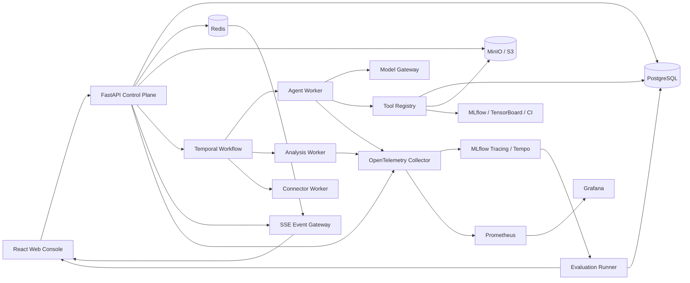

# ExperimentLens 修改扩充 2.0 项目方案

> 面向腾讯、字节跳动等互联网大厂后端、AI Infra、LLMOps、Agent 平台和机器学习平台岗位的拔尖项目规划

## 1. 文档目标

本方案不是继续增加零散页面，而是把当前“本地规则分析台 + 初步 Agent Runtime”升级成一个可以完整讨论架构、可靠性、可观测性、评测、安全和性能的实验诊断 Agent 平台。

项目最终应能回答五个面试问题：

1. 为什么要用 Agent，而不是把所有逻辑写进一个 Prompt？
2. 模型、工具、数据源和证据之间如何解耦并保证可信？
3. Worker 崩溃、SSE 断线、模型超时和重复消息发生时，系统如何恢复？
4. 如何证明新 Prompt、新模型或新工具真的比旧版本更好？
5. 如何从单机 Demo 演进到可部署、可压测、可观测、可审计的系统？

## 2. 2.0 项目定位

### 2.1 一句话定位

ExperimentLens 2.0 是一个面向机器学习、数据科学、推理 Benchmark 和 Agent Evaluation 的证据驱动实验诊断平台：它接入多种实验数据源，通过持久化 Agent 工作流调用受约束工具，实时展示诊断过程，并用离线评测、在线指标和人工反馈持续验证诊断质量。

### 2.2 与普通 Agent Demo 的区别

- 模型只做规划、工具选择、假设排序和解释。
- 指标计算、日志搜索、配置差异和证据解析由确定性工具完成。
- 所有结论必须绑定可校验的 EvidenceRef。
- AgentRun 是持久化状态机，不依赖某个 Web 进程一直存活。
- 每次模型、Prompt、工具或分析算法升级都必须经过固定评测集回归。
- 成本、延迟、失败率和证据覆盖率都是产品指标，而不是调试日志。

### 2.3 推荐应聘方向

| 岗位方向 | 项目中可重点展示的能力 |
|---|---|
| 后端开发 | API 契约、数据库建模、任务队列、幂等、缓存、SSE、限流、压测 |
| AI Infra / LLMOps | 模型网关、Agent Runtime、Trace、评测集、成本治理、模型回归 |
| 机器学习平台 | ExperimentSource、MLflow、指标与曲线标准化、实验回流 |
| Agent 平台 | 工具协议、状态机、审批、安全策略、记忆和证据校验 |
| 全栈开发 | React 工作台、实时事件流、Trace 树、评测和运营面板 |

## 3. 当前版本基线与差距

### 3.1 已有基础

- React + TypeScript + Redux + MUI + ECharts 前端。
- Flask API、Service 和 Repository 分层。
- Schema V2、多指标角色、约束检查和 Pareto 候选。
- 多格式数据导入、确定性统计、异常检测和实验建议。
- OpenAI Responses API 网关与离线确定性网关。
- 六个项目内只读工具。
- AgentRun 状态、步骤预算、Token 预算、超时、取消和重试。
- 先持久化再推送的 SSE 事件流、事件 ID 和断线续传。
- EvidenceRef 校验和“无工具证据拒绝回答”的门禁。
- 后端、前端、快照和文档测试。

### 3.2 限制项目含金量的主要问题

| 问题 | 当前表现 | 面试中的风险 |
|---|---|---|
| 单进程执行 | ThreadPoolExecutor 与 Flask 同进程 | 无法证明故障恢复和水平扩展 |
| 本地文件持久化 | JSON、JSONL、Parquet | 并发、一致性、查询和迁移能力不足 |
| Trace 未落地 | 有 TraceSpan 模型但没有完整链路 | 无法系统分析 Agent 质量和性能 |
| 缺少评测闭环 | 只有单元和集成测试 | 不能证明 Prompt/模型升级有效 |
| 数据源较单一 | 主要依赖文件上传 | 与真实 ML 平台连接不足 |
| Proposal 未闭环 | 只展示建议，不跟踪执行结果 | 产品故事停在“给建议” |
| 权限与安全不足 | 默认单用户、本地环境 | 缺少租户隔离与审计 |
| 缺少性能证据 | 没有压测、SLO 和容量模型 | “高并发”无法量化 |

## 4. 目标架构



### 4.1 架构原则

- 控制面和执行面分离：API 接受请求，Worker 执行长任务。
- 状态和事件分离：PostgreSQL 保存权威状态，Redis Streams 负责实时分发。
- 文件和元数据分离：大文件进入 MinIO/S3，数据库只保存索引、哈希和权限。
- 模型和工具解耦：模型网关不直接访问实验存储，所有访问经过 Tool Registry。
- 业务幂等优先：允许底层消息至少一次投递，但同一业务操作只产生一个有效结果。
- 可观测性默认开启：Trace、Metric、Log 从第一阶段进入接口设计。
- 先评测后发布：模型、Prompt、工具或 Detector 变更必须通过质量门禁。

## 5. 核心工程一：服务化与持久化工作流

### 5.1 API 层升级

推荐从 Flask 增量迁移到 FastAPI，而不是一次性重写：

1. 保留现有领域模型、Repository 和分析内核。
2. 先用 FastAPI 承接 Agent、SSE、Trace 和 Evaluation 新接口。
3. 通过契约测试保证旧 Flask API 与新 API 输出兼容。
4. 最后迁移项目、导入和报告接口。

推荐工具：FastAPI、Pydantic V2、Uvicorn、SQLAlchemy 2.0、Alembic、asyncpg 和 Schemathesis。

### 5.2 PostgreSQL 数据模型

至少包含：

```text
organizations / users / projects / project_members
experiment_sources / runs / metric_definitions / metric_points
parameters / artifacts / findings / hypotheses / proposals
agent_sessions / agent_runs / agent_events / tool_calls / evidence_refs
trace_spans / evaluation_datasets / evaluation_cases / evaluation_runs
evaluation_results / audit_logs
```

关键设计：

- 所有业务表包含 `organization_id` 或可追溯到 organization。
- AgentEvent 使用 `(agent_run_id, sequence)` 唯一索引。
- ToolCall 使用 `idempotency_key` 唯一索引。
- Artifact 使用内容哈希去重。
- MetricPoint 按项目、指标和时间进行索引或分区。
- 数据迁移支持前滚、回滚和旧工作区导入。

### 5.3 Temporal 持久化 Agent 工作流

推荐使用 Temporal Python SDK 替代进程内线程池。一个 AgentRun 对应一个 Workflow：

```text
CreateAgentRun
  → LoadProjectContext Activity
  → PlanWithModel Activity
  → ExecuteReadOnlyTool Activity
  → ValidateEvidence Activity
  → ContinueOrFinish
  → PersistAnswer Activity
```

必须实现：

- Workflow ID 使用 AgentRun ID，防止重复启动。
- Activity 设置超时、重试、最大尝试次数和非重试错误。
- ToolCall 使用幂等键，重放不能重复写入结果。
- 用户取消通过 Workflow cancellation 传播。
- 人工审批通过 Signal 恢复 Workflow。
- 预算通过 Workflow 状态统一扣减。
- Worker 崩溃并重启后继续执行未完成任务。

Temporal Workflow 用事件历史恢复状态，Task Queue 将任务路由到 Worker，适合展示持久化执行、失败恢复和水平扩展能力。

### 5.4 实时事件通道

```text
Worker → PostgreSQL AgentEvent → Transactional Outbox
       → Redis Streams → SSE Gateway → Browser
```

要求：

- 数据库事件与业务状态在同一事务写入。
- Outbox Publisher 可重复投递。
- SSE Gateway 按 sequence 去重并支持 `Last-Event-ID`。
- Redis 故障时允许从 PostgreSQL 回放事件。
- 慢客户端设置缓冲上限和断开策略。
- 心跳、重连、终态关闭和权限校验具有集成测试。

## 6. 核心工程二：模型网关与确定性工具平台

### 6.1 Provider-neutral Model Gateway

统一异步模型接口，实现 OpenAI Responses API、本地 Mock/Fallback，以及可选的第二个真实 Provider：

- Provider 选择、超时、限流、熔断、重试和错误分类。
- 输入、输出、推理和缓存 Token 分项统计。
- 模型价格版本化，保存估算成本和实际成本。
- Prompt 模板版本化并记录 Prompt hash。
- 敏感字段在送入模型前脱敏。
- Provider Request ID 用于追踪和取消。

不建议同时接入大量模型。两个真实 Provider 加一个 Mock 已足以展示抽象能力。

### 6.2 Tool SDK

每个工具声明：

```text
name / version / description
input_schema / output_schema
timeout / max_output_bytes
read_only / side_effect_level / requires_approval
required_permissions / evidence_policy
```

执行器支持：

- JSON Schema / Pydantic 严格校验。
- 项目与租户作用域自动注入，模型不得传入 scope。
- 工具结果大小限制和自动摘要。
- 同一参数重复调用检测。
- 超时、取消、隔离执行和结构化错误。
- 工具版本兼容和灰度发布。
- 工具输出始终作为不可信数据处理。

### 6.3 2.0 工具清单

| 工具 | 作用 | 权限 |
|---|---|---|
| `list_runs` | 查询 Run | 只读 |
| `compare_groups` | 组间统计 | 只读 |
| `inspect_metric_series` | 曲线、趋势和拐点 | 只读 |
| `search_logs` | 结构化日志检索 | 只读 |
| `diff_configs` | 配置差异 | 只读 |
| `get_finding_evidence` | 展开 Finding 证据 | 只读 |
| `detect_regression` | 与历史基线比较回归 | 只读 |
| `compare_environments` | CUDA、镜像和依赖差异 | 只读 |
| `retrieve_runbook` | 检索已审核排错知识 | 只读 |
| `estimate_experiment_cost` | 计算运行成本 | 只读 |
| `create_proposal_draft` | 保存方案草稿 | 写入、需审批 |
| `export_experiment_spec` | 导出 YAML/JSON | 写入、需审批 |
| `submit_experiment_job` | 提交外部实验 | 高风险、强审批 |

`submit_experiment_job` 放在最后阶段。重点展示审批、最小权限、幂等和审计，禁止让模型直接执行任意 Shell。

## 7. 核心工程三：Trace、日志、指标与成本可观测性

### 7.1 OpenTelemetry Trace

Trace 层级：

```text
agent.run
├── model.complete
├── tool.execute
│   ├── repository.query
│   └── evidence.build
├── evidence.validate
└── answer.persist
```

Span 至少记录：

- organization、project、session 和 agent_run ID。
- Agent、Prompt、模型和工具版本。
- 输入、输出、推理和缓存 Token，以及估算成本。
- 重试次数、错误类别、超时和取消原因。
- 工具输入摘要、输出摘要、排队时间和执行时间。
- EvidenceRef 数量和校验结果。
- 首 Token 延迟和模型总耗时。

遵循 OpenTelemetry GenAI Semantic Conventions；输入输出正文默认不进入 Span，仅在本地调试且明确授权时采样保存，避免 PII 和实验数据泄漏。

### 7.2 指标与 SLO

使用 Prometheus + Grafana，至少暴露：

```text
http_requests_total
http_request_duration_seconds
agent_runs_total{status}
agent_run_duration_seconds
agent_active_runs
agent_queue_delay_seconds
model_requests_total{provider,model,status}
model_request_duration_seconds{provider,model}
model_tokens_total{provider,model,type}
model_cost_total{provider,model}
tool_calls_total{tool,status}
tool_call_duration_seconds{tool}
sse_connections
sse_reconnects_total
evidence_validation_failures_total
evaluation_score{suite,metric,version}
```

指标 Label 禁止使用 user_id、run_id、trace_id 等高基数字段。延迟使用 Histogram，并通过 Exemplar 跳转到 Trace。

建议 SLO：

- API 月可用性：99.9%。
- 非模型读取接口 p95 < 200 ms。
- AgentRun 创建确认 p95 < 500 ms。
- SSE 已持久化事件丢失率：0。
- EvidenceRef 无效率：0。
- Worker 故障后未完成 Workflow 可恢复率：100%。

### 7.3 推荐可观测工具

- OpenTelemetry SDK + OpenTelemetry Collector。
- MLflow Tracing 或 Grafana Tempo / Jaeger。
- Prometheus + Grafana + Alertmanager。
- Loki 或结构化 JSON 日志。
- Sentry 用于前后端异常聚合。

MLflow Tracing 与 OpenTelemetry 兼容，并能记录模型、工具步骤、延迟和 Token；这使 Trace 可以继续进入评测数据集，而不是只用于排错。

## 8. 核心工程四：Agent 评测与质量门禁

### 8.1 三层评测体系

第一层：确定性代码评测

- EvidenceRef 是否存在。
- 数字是否来自工具输出。
- 是否调用越权工具。
- 工具参数是否符合 Schema。
- 是否遵守预算、最大步骤和审批规则。
- 相同 fixture 下确定性工具结果是否稳定。

第二层：轨迹评测

- Tool selection accuracy。
- Tool argument accuracy。
- 不必要工具调用比例。
- 重复调用比例。
- 诊断路径是否覆盖必要证据。
- 失败后是否选择正确恢复动作。

第三层：答案质量评测

- Groundedness、Correctness、Relevance。
- 假设与事实是否分离。
- 是否明确表达不确定性。
- 建议是否满足最小变量原则。
- 安全与敏感信息泄漏检查。

### 8.2 Golden Dataset

建立至少 100 个版本化用例，覆盖：

- 训练 OOM、NaN、过拟合和数据漂移。
- Seed 不稳定、样本量不足和统计显著但业务无意义。
- 准确率、延迟、显存和成本的多目标冲突。
- 日志中包含 Prompt injection 文本。
- 工具超时、模型超时、重复消息和部分数据缺失。
- 用户问题无法从当前证据回答。
- 跨项目越权读取和伪造 Run ID。

数据集来源包括手工 fixture、生产 Trace 脱敏回流、历史失败案例和对抗样本。

### 8.3 CI 质量门禁

每个 PR 执行快速评测集，每晚执行完整评测集：

```text
invalid_evidence_rate == 0
cross_project_access_success == 0
deterministic_tool_pass_rate == 1.0
agent_task_success_rate >= baseline - 1%
groundedness >= baseline
p95_latency <= baseline * 1.10
average_cost <= configured_budget
```

评测结果保存模型、Prompt、工具、Detector、数据集和代码 Commit 版本，生成对比报告。LLM Judge 只作为补充，关键安全和证据指标必须由代码判定。

## 9. 核心工程五：实验平台数据源与曲线诊断

### 9.1 ExperimentSource SPI

统一接口应支持分页列出 Run、读取单个 Run、增量获取 MetricPoint 和列出 Artifact。

第一批实现：

1. LocalFileSource。
2. MLflowSource。
3. TensorBoardSource。
4. CI Benchmark Source。

W&B 可作为加分项，不要阻塞主链路。

### 9.2 增量同步

- 使用 source cursor 和 watermark。
- 外部 Run ID 与本地 Run ID 分离。
- Upsert 使用 `(source_id, external_run_id)` 唯一键。
- Artifact 通过内容哈希去重。
- 同步任务支持断点续跑和速率限制。
- 删除采用 tombstone，不直接物理删除分析历史。
- 保存来源、同步时间和原始版本，保证 lineage。

### 9.3 曲线诊断

新增确定性分析：

- 收敛速度和达到目标阈值的 step/time。
- 最佳 checkpoint 和最终 checkpoint 差异。
- 训练/验证 gap。
- Plateau、振荡、梯度爆炸和发散信号。
- Early stopping 机会。
- 吞吐、显存和质量之间的 Pareto Front。
- 与历史基线的 change-point / regression 检测。

不要让模型直接对数万点曲线做自由文本判断。先由算法压缩成趋势特征，模型再解释。

## 10. 核心工程六：Proposal 审批、实验回流与验证

### 10.1 Proposal 状态机

```text
draft → pending_approval → approved → exported
      → submitted → running → completed → validated

异常分支：rejected / cancelled / failed / expired
```

### 10.2 审批与安全边界

- Agent 只能创建 Draft。
- 写文件、导出配置和提交任务分别定义风险等级。
- 高风险动作必须由具备权限的用户审批。
- 审批记录包含操作者、时间、差异、理由和策略版本。
- 提交前展示完整配置 Diff 和预计成本。
- 禁止任意 Shell；只允许模板化 Job Spec。
- Kubernetes ServiceAccount 使用最小 RBAC。

### 10.3 结果回流

Proposal 在新结果产生前保存 Decision Rule，例如：

```text
如果三次 seed 中至少两次主指标提升 >= 0.5%，
并且 p95 latency 不超过 baseline 的 105%，
则认为假设得到支持。
```

新 Run 通过 `proposal_id` 关联，完成后自动：

1. 拉取指标和 Artifact。
2. 执行 Decision Rule。
3. 更新 Hypothesis 状态。
4. 生成 before/after 对比。
5. 将成功或失败案例回流到评测数据集候选区。

## 11. 核心工程七：多租户、安全和供应链

### 11.1 身份与权限

- OIDC/OAuth2 登录，开发环境提供本地身份模拟器。
- Organization → Project → Resource 三级权限。
- RBAC 角色：Owner、Maintainer、Analyst、Viewer。
- 工具执行增加 permission scope。
- PostgreSQL 可选 Row Level Security 作为纵深防御。
- SSE、下载和对象存储签名 URL 都执行权限校验。

### 11.2 Secret 与数据保护

- API Key 只进入 Vault、云 Secret Manager 或 Kubernetes Secret。
- 数据库保存 Secret reference，不保存明文。
- 日志、Trace 和事件统一脱敏。
- Artifact 加密、内容类型检查、压缩炸弹防护和病毒扫描。
- 上传文件限制大小、扩展名、MIME 和解析超时。
- 设置数据保留策略和项目删除流程。

### 11.3 Agent 安全测试

- Prompt injection 和工具输出注入。
- 越权 scope 参数和审批绕过。
- 任意路径、目录穿越、SSRF 和恶意 URL。
- 超大输出、超长上下文与 Token 耗尽。
- 重放攻击和并发审批竞争。

### 11.4 软件供应链

- GitHub Actions。
- CodeQL / Semgrep 静态分析。
- pip-audit、pnpm audit、Dependabot 或 Renovate。
- Trivy 镜像扫描。
- Syft 生成 SBOM，Cosign 签名镜像。
- 固定依赖版本并验证 lockfile。

## 12. 核心工程八：性能、可靠性与混沌测试

### 12.1 压测工具与场景

推荐 Locust 测 API/SSE，k6 测浏览器侧接口并发：

| 场景 | 首版目标 |
|---|---:|
| 普通读取 API | 200 RPS，p95 < 200 ms，错误率 < 0.1% |
| AgentRun 创建 | 50 RPS，p95 < 500 ms |
| SSE 长连接 | 单实例 1,000 个 Mock 连接 |
| Mock Agent 并发 | 100 个并发 Workflow |
| 事件恢复 | 断线 60 秒后无丢失、无重复 UI 展示 |
| 导入 | 100 万 MetricPoint 可增量处理 |
| 评测 | 100 个用例支持并发、限流和断点续跑 |

这些数字是目标，不得直接写进简历。只有压测报告和复现脚本通过后，才能写成项目结果。

### 12.2 故障注入

- Worker 在工具执行前后崩溃。
- Redis 重启和网络抖动。
- PostgreSQL 短暂不可用。
- 模型返回 429、500、超时或格式错误。
- Tool 执行超时或输出过大。
- SSE 客户端慢消费和重复重连。
- 对象存储上传中断。

验证无状态损坏、业务结果不重复、预算不被重复扣减、事件可回放、错误可观测。

### 12.3 容量模型

形成容量计算文档：

```text
每日 AgentRun 数 × 平均步骤数 × 平均模型 Token
× 平均 ToolCall 数 × 平均事件数
= 模型成本、Worker QPS、数据库写入和事件存储需求
```

## 13. 核心工程九：部署、CI/CD 与本地可复现环境

### 13.1 本地环境

Docker Compose 一键启动 API、Web、Agent Worker、PostgreSQL、Redis、MinIO、Temporal Server/UI、OpenTelemetry Collector、Prometheus/Grafana 和 Trace Backend。

保留 `make demo` 或 `task demo`：自动导入样例、启动服务并生成一条完整 Agent Trace。

### 13.2 CI Pipeline

```text
lint → unit tests → integration tests → contract tests
→ security scan → build image → docker compose e2e
→ fast agent evaluation → publish reports and artifacts
```

主分支增加数据库迁移测试、前后兼容 API 测试、Playwright E2E、镜像和 SBOM，以及 Preview Environment。

### 13.3 Kubernetes

- API 使用 Deployment。
- Worker 按 Task Queue 拆分 Deployment。
- 批量评测和一次性导入使用 Job。
- HPA 根据 CPU、队列长度或自定义指标扩缩容。
- PodDisruptionBudget、readiness/liveness/startup probes。
- NetworkPolicy、ResourceQuota、LimitRange 和 Helm Chart。

Kubernetes Job 适合运行到完成的一次性任务；HPA 可根据资源或自定义指标调整副本数。面试中应解释为什么在线 API、长任务 Worker 和批处理 Job 采用不同工作负载模型。

## 14. 前端 2.0 功能

### 14.1 Agent Console

- 多轮 Session 和 AgentRun 历史。
- 工具调用时间线。
- Token、成本、步骤和时间预算实时显示。
- SSE 连接和恢复状态。
- 展开工具输入、输出摘要和 EvidenceRef。
- 取消、重试、Fork 和反馈。

### 14.2 Trace Explorer

- 瀑布图展示模型、工具、数据库和验证 Span。
- 按错误、模型、工具和版本过滤。
- 从指标 Exemplar 跳转到 Trace。
- 对比两个 Trace 的路径、延迟和成本。
- 敏感内容默认折叠并按权限解锁。

### 14.3 Evaluation Dashboard

- 模型、Prompt、工具版本对比。
- 成功率、Groundedness、延迟和成本趋势。
- 失败案例聚类。
- Baseline 与 Candidate 差异。
- 发布门禁结果和回滚入口。

### 14.4 Data & Proposal

- Source 同步状态、Cursor、错误和重试。
- 多指标曲线和 Pareto Front。
- Run、Finding、Trace 和 Evidence 双向跳转。
- Proposal Diff、审批、预计成本和 Decision Rule。
- 新实验结果回流后的自动验证页面。

## 15. 分阶段实施计划

### Phase 0：工程基线，1 周

- ADR、目标架构图和领域边界。
- Docker Compose 基础设施。
- FastAPI 新服务骨架。
- PostgreSQL + Alembic。
- CI、安全扫描和开发命令统一。

完成定义：新旧 API 契约测试通过，开发者一条命令启动全部基础设施。

### Phase 1：持久化 Agent Runtime，2 周

- Temporal Workflow 与 Activities。
- PostgreSQL AgentRun/ToolCall/Event Repository。
- Transactional Outbox + Redis Streams + SSE Gateway。
- 幂等、取消、重试、预算和恢复测试。

完成定义：随机杀死 Worker 后 AgentRun 能恢复，SSE 断线续传不丢事件。

### Phase 2：Trace 与 Evaluation，2 周

- OpenTelemetry 全链路 Trace。
- Prometheus/Grafana Dashboard。
- 100 条 Golden Dataset。
- 快速/完整评测集和 PR 门禁。
- Trace Explorer 与 Evaluation Dashboard。

完成定义：模型或 Prompt 变更能生成可比较的质量、成本和延迟报告。

### Phase 3：ExperimentSource 与曲线诊断，2 周

- MLflowSource、TensorBoardSource 和增量同步。
- MinIO Artifact 存储。
- 曲线特征、回归检测和 Pareto 分析。
- Source 管理页面。

完成定义：从真实 MLflow 项目同步 Run，并完成一次工具驱动诊断。

### Phase 4：Proposal 回流与安全治理，2 周

- Proposal 状态机和审批。
- 配置导出与模板化 Kubernetes Job。
- Decision Rule 和结果回流。
- OIDC、RBAC、Audit Log、Secret 管理和安全测试。

完成定义：从诊断到审批、运行、回流、验证形成完整闭环。

### Phase 5：性能与面试交付，1 周

- Locust/k6 压测。
- Worker、Redis、数据库故障演练。
- Helm Chart 和 Kind 部署。
- 性能报告、评测报告、架构说明和演示视频。

完成定义：所有简历数字都有脚本、报告和可复现实验支撑。

总周期建议 8 至 10 周。时间不足时必须完成 Phase 0 至 Phase 2，再从后续阶段选择最匹配目标岗位的部分。

## 16. 优先级裁剪

### 16.1 必做项

1. PostgreSQL + Alembic。
2. Temporal 持久化 Agent Workflow。
3. Transactional Outbox + Redis Streams + SSE。
4. OpenTelemetry Trace + Prometheus 指标。
5. Golden Dataset + Agent Evaluation CI。
6. MLflow ExperimentSource。
7. Docker Compose + GitHub Actions + 压测报告。

完成这七项后，项目已经能形成明显区别于普通课程项目的工程叙事。

### 16.2 加分项

- OIDC、RBAC、Audit Log。
- Proposal 审批和 Kubernetes Job 回流。
- MinIO Artifact、内容寻址和 lineage。
- Kind/Helm 部署和 HPA。
- Prompt injection 红队集。
- 多 Provider 模型路由和成本优化。

### 16.3 暂不建议投入

- 为了“复杂”而堆叠多个 Agent 框架。
- 自研向量数据库、消息队列或工作流引擎。
- 没有评测集就做自动 Prompt 优化。
- 允许模型直接执行任意 Python、Shell 或 SQL。
- 没有压测证据就宣称高并发或生产级。
- 展示或保存模型隐藏思维链；只记录必要步骤、工具和结构化决策摘要。

## 17. 工具选型总表

| 领域 | 推荐工具 | 选择理由 |
|---|---|---|
| Web API | FastAPI、Pydantic V2、Uvicorn | Async、类型契约、OpenAPI |
| 数据库 | PostgreSQL、SQLAlchemy、Alembic | 事务、索引、迁移、多租户 |
| 工作流 | Temporal Python SDK | 持久化执行、重试、取消、Signal |
| 实时事件 | Redis Streams、SSE | 回放、Consumer Group、浏览器兼容 |
| 对象存储 | MinIO / S3 | Artifact、签名 URL、内容哈希 |
| 模型 | OpenAI Responses API + Provider Adapter | 工具调用、统一网关、可替换 |
| Trace | OpenTelemetry、MLflow Tracing / Tempo | Agent Span、开放标准、评测回流 |
| Metric | Prometheus、Grafana、Alertmanager | SLO、容量和告警 |
| Log | structlog、Loki | 结构化日志与 Trace 关联 |
| Evaluation | pytest、MLflow GenAI Evaluation、自定义 Scorer | 确定性与模型质量回归 |
| 前端测试 | Vitest、Testing Library、Playwright | 单元、组件和端到端 |
| API 测试 | pytest、Schemathesis、Testcontainers | 契约、属性和真实依赖测试 |
| 压测 | Locust、k6 | API、SSE 和场景化负载 |
| 安全 | CodeQL、Semgrep、Trivy、pip-audit、pnpm audit | 代码、依赖和镜像扫描 |
| CI/CD | GitHub Actions、Docker Buildx | 自动验证和可复现镜像 |
| 部署 | Docker Compose、Kind、Helm、Kubernetes | 本地复现和集群演示 |
| 文档 | Mermaid、ADR、OpenAPI、MkDocs | 架构决策和接口可读性 |

## 18. 验收指标

### 18.1 功能与可靠性

- 六类实验 fixture、MLflow 项目和 TensorBoard 曲线均可分析。
- Agent 能组合至少 8 个只读工具完成诊断。
- Proposal 从 Draft 到结果验证全链路可演示。
- 所有关键结论可以跳转到 Run、Metric、Param、Log 或 Artifact。
- Worker 崩溃恢复测试通过。
- Redis 故障后从 PostgreSQL 恢复事件。
- ToolCall 重放不会产生重复业务结果。
- SSE 断线恢复无事件丢失。
- 数据库迁移支持空库、旧库和回滚测试。

### 18.2 Agent 与工程质量

- 无效 EvidenceRef 数量为 0。
- 跨项目读取成功数为 0。
- 安全工具绕过成功数为 0。
- Golden Dataset 关键用例通过率达到预设门槛。
- 每次发布保留 Baseline/Candidate 评测差异。
- 单元、集成、契约、E2E 和评测测试分层清晰。
- 核心模块覆盖率目标不低于 85%，但不追求无意义的全仓库覆盖率。
- CI 生成测试、评测、性能、安全和镜像报告。
- Docker Compose 与 Kind 环境可从空机器按文档启动。

## 19. 面试展示方案

### 19.1 十分钟演示脚本

1. 从 MLflow 同步一组包含失败 Run 的实验。
2. 展示 Schema、指标、约束和曲线自动识别。
3. 向 Agent 提问“为什么候选组均值更高但不建议发布”。
4. 展示实时模型和工具事件、Token、成本与预算。
5. 打开 Trace 瀑布图，解释模型和工具边界。
6. 点击 EvidenceRef 跳转到指标或日志原文。
7. 生成 Proposal，展示配置 Diff、审批和 Decision Rule。
8. 展示评测 Dashboard，比较两个 Prompt/模型版本。
9. 杀死 Worker，证明 Workflow 恢复。
10. 展示压测报告、SLO 和架构取舍。

### 19.2 面试重点话题

- 为什么选择 SSE 而不是 WebSocket。
- 为什么 Redis 不是 AgentRun 权威数据源。
- Outbox 如何解决数据库提交与事件发布双写问题。
- Temporal Activity 为什么必须幂等。
- Token 预算和工具预算如何统一核算。
- LLM Judge 为什么不能替代确定性校验。
- 如何避免 Prompt injection 通过日志进入模型指令。
- 指标 Label 为什么不能放 Run ID。
- 如何设计多租户 scope，防止模型越权。
- 如何证明性能数字可复现。

### 19.3 简历描述模板

以下数字必须在完成压测和评测后替换，不能直接使用占位数字：

> 设计并实现证据驱动的实验诊断 Agent 平台，将模型规划与确定性工具执行解耦；基于 Temporal 构建可恢复工作流，使用 PostgreSQL Outbox + Redis Streams 实现可续传 SSE 事件链路，在 X 个并发 AgentRun 下实现 p95 延迟 Y、事件丢失率 0。

> 建立覆盖 Z 个失败模式的 Agent 评测集与 CI 质量门禁，评估工具轨迹、证据有效性、Groundedness、延迟和成本，使无效证据率保持 0，并将任务成功率从 A 提升至 B。

> 基于 OpenTelemetry、Prometheus 和 MLflow Tracing 建立模型、工具、数据库全链路可观测性，支持从告警定位到 Trace、ToolCall 和 EvidenceRef，完成 Worker/Redis 故障恢复与容量压测。

## 20. 建议仓库结构

```text
experimentlens/
├── apps/                  # web / api / worker
├── packages/              # domain / agent-runtime / tool-sdk
│   ├── analysis-engine/
│   ├── connectors/
│   └── observability/
├── migrations/
├── evals/                 # datasets / scorers / reports
├── deploy/                # compose / helm / grafana
├── tests/                 # unit / integration / contract / e2e / load / chaos
├── docs/                  # adr / architecture / runbooks
└── .github/workflows/
```

不建议第一天就机械调整全部目录。应在服务边界真正出现时逐步迁移，每次提交保持可运行。

## 21. 参考资料

- [Temporal Workflow](https://docs.temporal.io/workflows)
- [Temporal Task Queues](https://docs.temporal.io/task-queue)
- [OpenTelemetry GenAI Semantic Conventions](https://opentelemetry.io/docs/specs/semconv/registry/attributes/gen-ai/)
- [MLflow Agent Tracing](https://mlflow.org/docs/latest/genai/tracing)
- [MLflow Trace Evaluation](https://mlflow.org/docs/latest/genai/eval-monitor/running-evaluation/traces/)
- [Kubernetes Jobs](https://kubernetes.io/docs/concepts/workloads/controllers/job/)
- [Kubernetes Horizontal Pod Autoscaling](https://kubernetes.io/docs/concepts/workloads/autoscaling/horizontal-pod-autoscale/)
- [Prometheus Instrumentation Best Practices](https://prometheus.io/docs/practices/instrumentation/)
- [GitHub CodeQL Code Scanning](https://docs.github.com/en/code-security/concepts/code-scanning/codeql/codeql-code-scanning)

## 22. 最终完成定义

ExperimentLens 2.0 不是以“接入了大模型”作为完成标准，而是同时满足：

1. Agent 工作流可恢复、可取消、可审计。
2. 工具执行确定、受限、幂等且可评测。
3. 实时事件可持久化、可续传、可回放。
4. 模型、工具、数据源和 Prompt 版本可追踪。
5. 诊断结论具有可验证证据，越权和伪造证据被阻断。
6. 质量、延迟、成本和可靠性都有自动化基线。
7. 从数据同步、诊断、Proposal 到结果验证形成闭环。
8. 架构、测试、压测和故障演练均有可复现材料。

达到以上标准后，这个项目才能从“功能丰富的个人项目”升级为能够在大厂面试中讨论系统设计、Agent 工程、LLMOps、数据平台与工程质量的完整代表作。
