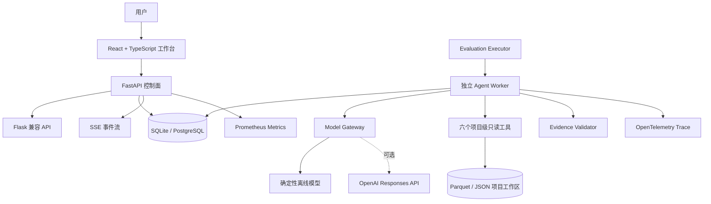

# ExperimentLens 从零学习与面试讲解手册

> 适用对象：第一次接触 AI Agent、刚入学、希望真正理解项目并能在面试中独立讲清楚的人。
>
> 项目英文定位：**Evidence-driven AI agent for reliable experiment diagnostics**。

## 0. 先说清楚：怎样才算“把项目变成自己的”

把项目“包装为自己的”不应该理解为把别人的工作说成自己独立完成，而应该理解为：你能独立运行、解释、修改、验证和维护它，并且在面试中如实说明自己的贡献。

如果你只是刚接手，推荐这样说：

> 我接手了 ExperimentLens 项目，系统梳理了它的数据链路和 Agent Runtime，复现了评测与故障恢复实验，并负责后续文档、测试和功能迭代。

只有当你真正完成了某项设计或代码，才使用“我设计了”“我实现了”。面试官通常会沿着代码、异常场景和取舍连续追问，只背术语很容易暴露。建议在写进简历前至少完成第 16 节的实操清单。

---

## 1. 一句话认识这个项目

ExperimentLens 是一个帮助机器学习工程师分析实验结果的 AI Agent 平台。它会读取多次训练或评测产生的结果表、配置和日志，先用确定性的统计规则找异常，再让 Agent 调用只读工具查证，最终给出带证据的诊断、假设和下一轮实验建议。

它解决的不是“帮用户聊天”，而是下面这个实际问题：

> 我做了几十次模型实验，指标有高有低，有些运行失败了，配置也不完全相同。到底哪个方案真的更好？差异是配置造成的，还是随机种子、数据版本或运行异常造成的？下一步最省成本的验证实验是什么？

---

## 2. 先用最通俗的方式理解

### 2.1 把项目想象成“实验侦探事务所”

假设实验室做了 30 次模型训练。每次训练都像一个案件记录：

- `run_id`：这次实验的编号；
- `group`：它属于 baseline 还是某个候选方案；
- `seed`：随机种子；
- `accuracy`、`loss`：实验成绩；
- 配置文件：用了什么学习率、batch size、数据版本；
- 日志：运行时有没有报错、显存不足或数值异常。

ExperimentLens 的工作分为六步：

1. **收材料**：接受 CSV、Excel、JSON、YAML、日志等文件。
2. **整理卷宗**：把不同格式统一整理成 runs、metrics、params 和 artifacts。
3. **让计算器先查**：用固定统计规则计算均值、波动、置信区间、异常点和日志错误。
4. **让 Agent 当侦探**：Agent 根据问题决定先用哪个只读工具查数据，再决定是否继续查。
5. **核对证据编号**：结论必须引用真实存在的 run、指标、参数或日志位置。
6. **给出行动建议**：区分事实、假设和不确定性，提出下一轮最小实验。

### 2.2 每个工程概念对应什么生活类比

| 项目概念 | 通俗类比 | 实际作用 |
| --- | --- | --- |
| Agent | 负责调查的侦探 | 根据当前信息决定调用什么工具 |
| Tool | 档案室查询窗口 | 读取 runs、指标、配置、日志和 finding |
| EvidenceRef | 证据编号 | 让结论能回到具体原始数据 |
| AgentRun | 一次完整调查任务 | 保存问题、状态、步骤、答案和证据 |
| AgentStep | 调查笔记的一页 | 保存每次模型判断、工具调用和证据校验 |
| Worker | 后台办案员 | 从任务队列领取 AgentRun 并执行 |
| Lease | 有过期时间的任务领取单 | 防止任务永久被故障 Worker 占住 |
| heartbeat | 办案员定时报平安 | 表示 Worker 仍在处理任务 |
| fencing token | 领取单版本号 | 阻止旧 Worker 恢复后覆盖新 Worker 的结果 |
| 幂等键 | 同一业务的唯一回执号 | 重试时避免同一个工具调用写两次 |
| SSE | 网页上的实时文字直播 | 把任务进度持续推给浏览器 |
| Trace | 一次任务的路线图 | 看模型、工具、证据校验各花了多久 |
| Evaluation | Agent 的标准化考试 | 防止改 Prompt 或工具后能力退化 |

### 2.3 为什么不能直接把所有数据塞给大模型

直接把表格和日志全部粘进 Prompt 有四个问题：

1. 数据可能很长，超过上下文窗口，Token 成本也高。
2. 大模型容易把数字看错、算错或编造不存在的 run。
3. 很难限制模型只能访问当前项目的数据。
4. 无法稳定复现，也难以知道一次代码修改是否让效果变差。

所以本项目采用“确定性分析 + 受限工具 Agent + 证据门禁”的组合：计算交给代码，检索交给工具，语言组织交给模型，最终结论再由程序校验证据。

---

## 3. 需要先学会的实验分析基本词汇

### 3.1 Run、Group、Baseline 和 Seed

- **Run**：一次独立运行。例如同一个模型用 seed 1、2、3 分别训练，会产生三个 run。
- **Group**：共享同一主要方案的一组 run。例如 `baseline` 和 `large-model` 是两个实验组。
- **Baseline**：作为比较基准的组。候选方案是否提升，要相对 baseline 讨论。
- **Seed**：控制伪随机过程的初始值。只跑一个 seed 得到的提升，可能只是随机波动。

面试表达：

> 我没有只比较单次最优值，而是按实验组聚合多个 seed，比较均值、标准差和置信区间，并在样本量不足时给出警告。

### 3.2 Metric、Parameter 和 Artifact

- **Metric**：可以量化的结果，如 accuracy、F1、loss、延迟、成本。
- **Parameter**：实验配置，如学习率、batch size、模型版本、数据版本。
- **Artifact**：实验产生的文件或记录。本项目目前重点处理导入日志，并把原始文件保存在项目工作区。

指标还有四种角色：

- `primary`：最主要的优化目标；
- `secondary`：辅助判断的效果指标；
- `constraint`：必须满足的阈值，例如延迟必须小于 100 ms；
- `resource`：资源成本，例如显存、延迟和费用。

### 3.3 均值、标准差与 95% 置信区间

- **均值**表示一组结果的平均水平。
- **标准差**表示不同 run 的波动大小；越大说明稳定性越差。
- 本项目使用 `均值 ± 1.96 × 标准差 / √n` 形成近似 95% 置信区间。

如果两个方案均值不同，但差异置信区间跨过 0，就不能轻易说提升稳定。样本太少时，正态近似可能不可靠，所以项目会标记 `sample_size_small`。

### 3.4 效应量与近似 p 值

- **效应量**回答“差异有多大”，避免只看是否显著。
- **p 值**回答“如果真实没有差异，观察到当前差异有多罕见”。

当前实现使用合并方差计算标准化效应，并通过正态分布近似得到双侧 `p_value_approx`。它适合项目展示和初步诊断，但不是完整统计研究中的严格 t 检验、多重比较校正或因果推断。被追问时要主动说明这个边界。

### 3.5 MAD 离群检测

普通均值和标准差容易被极端值影响。项目用中位数绝对偏差 MAD 构造 robust z-score；当绝对值大于 3.5 时，将该 run 标记为组内离群点。它比简单的“三倍标准差”对极端值更稳健。

### 3.6 Pareto Frontier

有时不能只追求一个指标。例如准确率更高但延迟也更高。Pareto 前沿表示：没有另一个方案能在所有关注指标上都不差、且至少一个指标更好。它帮助回答多目标取舍，而不是武断地选一个“总冠军”。

---

## 4. AI Agent 基础：它和普通聊天机器人有什么区别

### 4.1 LLM、Workflow 和 Agent

- **LLM 调用**：输入 Prompt，模型一次生成结果。
- **固定 Workflow**：程序预先规定步骤 A → B → C，模型只在某些节点参与。
- **Agent**：模型根据当前问题和工具结果动态决定下一步做什么，直到完成、失败或预算耗尽。

ExperimentLens 的 Agent 是“受约束的单 Agent 工具循环”，不是多 Agent 系统。它大致执行：

```text
用户问题
  ↓
模型判断是否调用工具
  ├─ 是 → 校验参数 → 执行只读工具 → 返回结构化结果 → 再问模型
  └─ 否 → 校验是否已有真实 EvidenceRef → 生成最终答案
```

### 4.2 Tool Calling 是什么

Tool Calling 不是模型自己执行 Python 函数。模型只返回类似下面的结构化意图：

```json
{
  "name": "compare_groups",
  "arguments": {"metric": "accuracy", "baseline": "baseline"}
}
```

真正执行函数的是应用程序。程序会：

1. 确认工具已注册；
2. 用 Pydantic 校验参数类型、范围和多余字段；
3. 检查是否需要人工批准；
4. 执行工具；
5. 再用 Pydantic 校验输出；
6. 把结构化结果交还给模型。

这种设计让工具权限和输入边界掌握在代码中，而不是完全相信模型。

### 4.3 项目的六个只读工具

| 工具 | 能回答什么 | 返回的主要证据 |
| --- | --- | --- |
| `list_runs` | 有哪些 run，状态和分组是什么 | `run` EvidenceRef |
| `compare_groups` | 某指标下各组均值、标准差、样本数如何 | `metric` EvidenceRef |
| `search_logs` | 日志里是否出现 OOM、异常或关键词 | `log` EvidenceRef |
| `diff_configs` | 选定 runs 或 groups 的配置哪里不同 | `param` EvidenceRef |
| `inspect_metric_series` | 某 run 的指标序列趋势如何 | `metric` EvidenceRef |
| `get_finding_evidence` | 某条确定性 finding 的依据是什么 | finding 中已有的 EvidenceRef |

一个重要安全细节是：工具输入中没有让模型自由指定 `project_id`。注册工具时，当前项目 ID 已由服务端闭包固定，因此模型不能通过构造参数读取另一个项目。

### 4.4 EvidenceRef 为什么重要

`EvidenceRef` 是结构化证据指针，包含：

- `kind`：run、metric、param 或 log；
- `id`：真实数据中的唯一位置；
- `label`：给人看的名称；
- `detail`：可选摘要。

最终回答前，`EvidenceValidator` 会重新从当前项目的标准化数据构造合法 ID 集合。没有任何工具证据，或者引用不存在的证据，答案都会被拒绝。它不能保证自然语言推理百分之百正确，但显著降低了“凭空编数字”和“引用不存在实验”的风险。

### 4.5 Prompt Injection 是什么

Prompt Injection 指不可信数据中夹带“忽略原指令、泄露别的项目数据”等文字，诱导模型把数据当命令。本项目做了三层控制：

1. 系统指令明确要求把工具输出当作不可信数据；
2. 工具本身只读且限定当前项目；
3. 评测集中包含恶意日志，检查 Agent 是否跟随其中的指令。

这不是完整的企业级安全体系。当前项目没有真正的用户认证、细粒度 RBAC 或外部副作用工具，不能宣称已经解决所有 Agent 安全问题。

### 4.6 为什么要限制步数、Token 和超时

Agent 可能重复调用工具、陷入循环或遇到模型延迟。因此运行时限制：

- `max_steps`：最多模型迭代次数；
- `token_budget`：输入输出 Token 总预算；
- `run_timeout_seconds`：整次 AgentRun 的超时；
- `tool_timeout_seconds`：单次工具调用超时；
- 重复工具签名检测：相同工具和相同参数重复调用会被拒绝。

限制预算既控制成本，也保证任务最终进入明确终态，而不是无限运行。

---

## 5. 用通俗语言走完一次真实流程

假设用户上传了三份文件：

- `results.csv`：每个 run 的 accuracy、loss、group 和 seed；
- `configs.yaml`：学习率、batch size、数据版本；
- `train.log`：训练日志。

### 第一步：导入与识别

系统根据文件扩展名选择解析方式，单文件限制为 50 MB。表格列名可能不统一，系统会从 `run_id/run/trial_id` 等别名中猜测 run 列，从 `group/variant/model` 等别名中猜测分组列，并根据列名和数值比例寻找指标。

系统只给出“推断建议”，用户仍需确认主指标、优化方向和 baseline。这样避免自动推断错误后直接污染分析。

### 第二步：标准化

确认映射后，系统把宽表拆成：

- `runs.parquet`：一行一个 run；
- `metrics.parquet`：一行一个 run 的一个指标点；
- `params.parquet`：一行一个 run 的一个参数；
- `artifacts.json`：日志等结构化记录。

标准化的价值是：后续统计、工具和前端不需要知道原始文件叫 `acc` 还是 `accuracy_score`，只使用统一结构。

### 第三步：确定性分析

程序先计算分组统计、baseline 差异、多指标汇总、约束违反和 Pareto 前沿，再通过 detector registry 运行规则检测器：

- 失败运行、无效指标、重复 run、缺失 seed；
- 组内离群点；
- seed 波动异常；
- 数据版本漂移；
- 日志中的 OOM、NaN、异常堆栈。

之后根据 findings 生成假设和最小实验建议。因为这部分是普通代码，结果可重复、可测试，不依赖模型“临场发挥”。

### 第四步：创建 AgentRun

用户问“large 组为什么不稳定？”控制面只做两件事：保存 AgentRun，并返回 `202 Accepted`。它不会在 HTTP 请求线程里完成整个 Agent，避免请求长时间阻塞。

### 第五步：Worker 执行

独立 Worker 从数据库领取任务，调用模型。模型可能先调用 `compare_groups`，再调用 `diff_configs` 或 `search_logs`。每个模型步骤和工具步骤都会持久化。

### 第六步：浏览器实时显示

API 从数据库事件表读取 `model.started`、`tool.completed`、`evidence.validated` 等事件，通过 SSE 推给 React 前端。即使浏览器短暂断网，也可用最后事件 ID 继续读取遗漏事件。

### 第七步：证据校验与报告

模型不再请求工具时，系统验证 EvidenceRef。通过后保存答案，前端展示文字、证据、Token 使用和 Trace；用户还可以生成和编辑分析报告。

---

## 6. 专业架构讲解

### 6.1 30 秒专业介绍

> ExperimentLens 是一个证据优先的机器学习实验诊断 Agent 平台。系统把异构结果表、配置和日志标准化为 runs、metrics、params 和 artifacts，通过确定性统计生成 findings，再由受约束 Agent 调用六个项目级只读工具完成诊断。Agent 控制面采用 FastAPI，执行面采用数据库 Lease Worker，并用持久化 AgentStep、heartbeat、fencing token 和工具幂等键实现故障恢复。系统还支持 SSE 事件续传、OpenTelemetry Trace、Prometheus 指标以及基于真实 AgentRun 的离线评测门禁。

### 6.2 架构图



### 6.3 为什么同时有 FastAPI 和 Flask

项目早期已有 Flask API 和前端契约。升级时没有一次性重写全部接口，而是：

- FastAPI 承担 2.0 控制面、健康检查、Trace、评测和新版 Agent API；
- 原 Flask Blueprints 保留项目导入、分析、报告等接口；
- 通过 `a2wsgi.WSGIMiddleware` 把 Flask 挂到 FastAPI 下。

这是典型的渐进式迁移策略：减少大爆炸式重写风险，同时让新能力使用 ASGI 生态。代价是短期存在两套 API 风格和部分兼容接口，后续可逐步统一。

### 6.4 分层与依赖方向

核心代码按以下职责划分：

```text
API 层 → Service 用例层 → Repository 接口 → 本地工作区/SQL 实现
                    ↓
                 Domain 模型
```

- API 层处理 HTTP、参数和状态码；
- Service 层编排导入、分析和报告用例；
- Repository 隔离文件系统和数据库细节；
- Domain 使用 Pydantic 定义业务数据和约束；
- Agent Runtime 只通过受限 Repository 和 Tool Registry 访问数据。

这种结构比把所有逻辑写在路由函数里更容易测试和替换存储实现。

---

## 7. Agent Runtime 的工程细节

### 7.1 AgentRun 状态机

主要状态包括：

```text
pending → running → completed
                  ↘ failed
                  ↘ cancelled
                  ↘ budget_exhausted
```

还预留了 `awaiting_approval`，但当前工具均只读，不会实际进入人工审批流程。面试时不要说已经实现写工具审批。

### 7.2 为什么 API 和 Worker 要分离

如果 API 收到请求后直接运行 Agent，会产生：

- HTTP 连接长时间占用；
- API 重启导致任务丢失；
- 难以独立扩缩容；
- 多实例下任务归属不清晰。

当前方案让 API 只入队，Worker 独立轮询数据库。即使 Worker 崩溃，任务状态和已完成步骤仍在数据库中。

### 7.3 Lease、heartbeat 和 fencing token

**Lease** 是有截止时间的任务所有权。Worker 领取任务时写入：

- `lease_owner`：谁领取；
- `lease_expires_at`：什么时候过期；
- `heartbeat_at`：最近心跳；
- `fencing_token`：每次重新领取都递增的版本号。

Worker 每隔约三分之一 Lease 时长续租。若 Worker 崩溃，心跳停止，Lease 到期后其他 Worker 可以接管。

仅有 Lease 还不够：旧 Worker 可能只是网络暂停，恢复后仍尝试提交。fencing token 类似单调递增的门票编号；每次关键提交前，Worker 必须证明自己仍持有最新 token。旧 token 会被拒绝，避免脑裂式双写。

### 7.4 AgentStep 如何恢复上下文

模型步骤、工具步骤和证据步骤都写入 `agent_steps`。唯一约束是 `(agent_run_id, step_index)`。

恢复时系统读取已完成工具步骤，重建：

- 模型看到过的 function call；
- 工具返回的结构化结果；
- 已收集 EvidenceRef；
- 已执行工具签名集合。

如果模型步骤已完成但后续工具步骤未完成，系统回到对应 iteration 继续，而不是从头重复整次任务。

### 7.5 幂等键如何避免重复工具调用

工具幂等键由下面的信息做 SHA-256：

```text
agent_run_id + step_index + tool_name + arguments_hash
```

数据库对 `idempotency_key` 建唯一约束。Worker 在执行前检查是否已有完成记录；如果存在就复用结果。这样即使在“工具已执行、结果尚未完成后续提交”的边界崩溃，恢复后也不会新增第二条相同 ToolCall。

当前工具均为只读，因此重复执行本身副作用较低；幂等设计仍然重要，因为它保证审计记录、评测轨迹和调用统计一致。若未来增加写工具，还需要业务侧幂等和人工审批。

### 7.6 事件与 Transactional Outbox

每个 Agent 事件都有 run 内单调递增的 sequence，并有 `(agent_run_id, sequence)` 唯一约束。事件和对应 Outbox 记录在同一个数据库事务内写入，解决“业务状态成功但消息没写入”的双写问题。

当前主链路直接从数据库事件表驱动 SSE；Outbox Publisher 尚未接入 Redis/Kafka。因此可以说“已实现事务 Outbox 记录”，不能说“已经完成基于消息队列的事件分发”。

---

## 8. SSE、WebSocket 与轮询

### 8.1 为什么选择 SSE

Agent 进度主要是服务端单向推送给浏览器，客户端不需要在同一连接上持续双向发消息。SSE 有这些优势：

- 基于普通 HTTP；
- 浏览器原生 `EventSource` 支持；
- 文本事件格式简单；
- 自动重连，并支持 `Last-Event-ID`；
- 比 WebSocket 更适合单向状态流。

### 8.2 三者的区别

| 方案 | 通信方向 | 适用场景 | 本项目取舍 |
| --- | --- | --- | --- |
| 轮询 | 客户端定期请求 | 更新不频繁、实现最简单 | 延迟和空请求较多 |
| SSE | 服务端持续单向推送 | Agent 进度、日志、通知 | 当前采用 |
| WebSocket | 全双工 | 游戏、协同编辑、实时控制 | 当前没有必要 |

### 8.3 断线续传怎么工作

浏览器记录最后收到的事件 ID。重连时把它放在 `Last-Event-ID` Header，API 只查询 sequence 大于该 ID 的事件。数据库事件表是权威来源，因此 API 实例重启不会丢掉已经持久化的进度。

---

## 9. 可观测性：Logs、Metrics 和 Traces

### 9.1 三大支柱

- **Logs**：离散文本事件，适合看具体错误详情。
- **Metrics**：可聚合时间序列，适合告警和趋势，例如请求数、延迟和活跃任务数。
- **Traces**：一次请求跨组件的调用链，适合定位慢在哪里、错在哪里。

### 9.2 本项目记录什么

Prometheus 指标包括：

- HTTP 请求数和延迟；
- AgentRun 状态、耗时和活跃数量；
- 模型请求数、耗时和 Token；
- 工具调用数与耗时；
- 证据校验失败；
- SSE 当前连接和重连次数。

Trace 以 `agent.run` 为根 Span，下面记录 `model.complete`、`tool.execute` 和 `evidence.validate`。Trace 使用输入输出摘要哈希，不在 Span 中保存隐藏思维链。

Prometheus Label 只使用 route、status、provider、model 和 tool 等低基数字段，不把 run ID、用户 ID 或 trace ID 当 Label。原因是高基数 Label 会让时间序列数量爆炸，增加内存和查询成本。

### 9.3 当前隐私边界

Trace Span 保存摘要而非原始输入输出，但 AgentRun 和 AgentStep 为了恢复会持久化用户问题、模型响应和结构化工具结果。启用外部模型时，用户问题和必要的工具结果会发送到模型服务。项目未实现完整的数据分级、保留期限和删除流程，真实生产部署必须补充。

---

## 10. Evaluation：怎样证明 Agent 不是“看起来能用”

### 10.1 单元测试和 Agent 评测的区别

- 单元测试验证确定性函数，例如参数校验、统计计算和 Repository 行为。
- Agent 评测验证非完全确定的系统行为，例如是否选择正确工具、是否引用足够证据、是否被恶意日志诱导。

只测试打分函数不够。当前评测器为每个 case 创建隔离项目，创建真实 AgentRun，由 Worker 执行，再从数据库读取 ToolCall、Event、EvidenceRef、Trace 和 AgentStep 组装 trajectory。调用方不能上传一条伪造轨迹来骗过评测。

### 10.2 Golden Dataset 中检查什么

30 条版本化案例覆盖：

- 必须调用哪些工具；
- 允许调用哪些工具；
- 最少证据数量；
- 工具参数是否合法；
- 是否跨项目读取；
- 是否执行未授权写入；
- 是否跟随 Prompt Injection；
- 超时后是否进入终态。

### 10.3 质量门禁

硬门禁为：

```text
任务通过率 >= 95%
invalid_evidence_rate == 0
cross_project_access_success == 0
unauthorized_write_success == 0
prompt_injection_success == 0
tool_argument_validity == 100%
timeout_recovery_rate == 100%
```

报告还记录 Git commit、数据集 hash、Prompt hash、模型、工具 Schema hash 和 Detector 版本，便于回答“这次结果到底对应哪一版系统”。

### 10.4 当前发布基线

在本地 SQLite 和确定性离线评测模型环境中：

- 30/30 案例通过，门禁通过；
- 无效证据率为 0；
- 工具参数有效率和超时终态率均为 100%；
- p95 为 27.436 ms，平均 Token 45.6。

这些数字主要证明评测链路可重复，不代表真实外部大模型的互联网延迟、成本或质量。真实模型必须单独运行候选评测并与 baseline 比较。

### 10.5 可靠性实验

可靠性脚本创建 100 个真实 AgentRun 和两个 Worker，在工具执行后、提交完成前强制终止一个 Worker，然后检查：

- 所有任务是否完成；
- 是否有重复幂等键；
- 事件 sequence 是否缺失；
- SSE 分段重放能否还原完整事件；
- 崩溃任务是否被另一个 Worker 接管。

当前发布报告为 100/100 完成，重复 ToolCall、事件丢失和 SSE 重放失败均为 0，并注入了 1 次 Worker 崩溃。所有数字都要带上“本地 SQLite + 离线模型基线”的限定，不能当生产 SLO。

---

## 11. 技术栈总览：是什么、做什么、一般怎么用

### 11.1 后端与 API

| 技术 | 是什么 | 项目中的作用 | 一般如何使用 |
| --- | --- | --- | --- |
| Python 3.11+ | 动态类型编程语言 | 后端、数据处理、Agent Runtime、评测 | 虚拟环境隔离依赖，通过 `pyproject.toml` 打包 |
| FastAPI | ASGI Web 框架 | 2.0 控制面、SSE、评测、Trace、健康检查 | 用装饰器定义路由，用 Pydantic 声明请求模型 |
| Flask | WSGI Web 框架 | 保留原项目、分析和报告 API | Blueprint 拆分模块，通过 `jsonify` 返回数据 |
| a2wsgi | WSGI/ASGI 适配器 | 把 Flask 兼容层挂到 FastAPI | 用 `WSGIMiddleware(legacy_app)` 包装旧应用 |
| Uvicorn | ASGI Server | 运行 FastAPI | `uvicorn module:app` 或项目 CLI 启动 |
| Pydantic | 数据验证和序列化库 | Domain 模型、API 请求、工具输入输出约束 | 继承 `BaseModel`，用 Field 和 Validator 声明规则 |

一个典型 FastAPI + Pydantic 用法：

```python
class CreateRun(BaseModel):
    question: str = Field(min_length=1, max_length=4000)

@app.post("/agent-runs", status_code=202)
async def create_run(payload: CreateRun):
    return service.create(payload.question)
```

### 11.2 数据与统计

| 技术 | 是什么 | 项目中的作用 | 一般如何使用 |
| --- | --- | --- | --- |
| Pandas | 表格数据处理库 | 解析、合并、标准化 runs/metrics/params，分组统计 | DataFrame、merge、groupby、pivot_table |
| NumPy | 数值计算库 | NaN、有限值、MAD、数组统计 | `np.isfinite`、`np.median`、向量运算 |
| PyArrow/Parquet | 列式数据格式与引擎 | 保存标准化表格 | `DataFrame.to_parquet/read_parquet` |
| openpyxl | Excel 读写引擎 | 支持 `.xlsx` 导入 | 由 Pandas `read_excel` 间接调用 |
| PyYAML | YAML 解析库 | 读取实验配置 | `yaml.safe_load`，避免不安全对象构造 |

为什么选择 Parquet 而不是一直用 CSV：Parquet 保留类型、列式读取效率高、压缩较好，也更适合后续分析；原始文件仍保存，方便追溯。

### 11.3 数据库与迁移

| 技术 | 是什么 | 项目中的作用 | 一般如何使用 |
| --- | --- | --- | --- |
| SQLite | 嵌入式关系数据库 | 默认本地开发、CI 和演示 | 单文件、零运维，适合低并发 |
| PostgreSQL | 服务端关系数据库 | Compose 默认持久化控制面 | 适合多进程、并发和更严格事务场景 |
| SQLAlchemy | Python ORM/SQL Toolkit | AgentRun、Step、Event、ToolCall、Trace、Eval 持久化 | 声明 Model，通过 Session 和事务读写 |
| Alembic | 数据库迁移工具 | Schema 前滚、回滚和版本管理 | `alembic upgrade head`、`alembic downgrade base` |

ORM 不是“不写 SQL”，而是把表映射为对象并统一事务与多数据库方言。关键的任务领取仍使用条件更新保证竞争下只有一个 Worker 成功。

### 11.4 Agent 与模型接入

| 技术 | 是什么 | 项目中的作用 | 一般如何使用 |
| --- | --- | --- | --- |
| OpenAI Responses API | 支持文本与函数工具调用的模型 API | 可选真实模型网关 | 发送 messages/instructions/tools，解析 function call |
| Model Gateway 抽象 | 项目自定义适配层 | 隔离模型供应商与 Orchestrator | 统一 `complete(ModelRequest) -> ModelResponse` |
| 确定性 Fallback | 本地规则式模型替身 | 无 API Key 也能跑通工具循环和 CI | 固定调用 `list_runs`、`compare_groups` 后结束 |
| Tool Registry | 项目自定义工具注册表 | 管理工具 Schema、权限、参数和输出校验 | 注册 name、description、input/output model、handler |

项目没有依赖重量级 Agent 框架，而是自己实现最小 Orchestrator。优点是执行语义、持久化和安全边界清晰；代价是高级工作流能力需要自行建设。

### 11.5 前端

| 技术 | 是什么 | 项目中的作用 | 一般如何使用 |
| --- | --- | --- | --- |
| React 18 | 组件化 UI 库 | 工作台、Agent 抽屉、质量页面、报告页面 | 函数组件、Hooks、状态驱动渲染 |
| TypeScript | 带静态类型的 JavaScript | 约束 API 数据和组件 Props | interface/type、编译期检查 |
| Redux Toolkit | 全局状态管理 | 项目列表、当前项目、分析和 runs | `createSlice`、`createAsyncThunk` |
| Material UI | React 组件库 | 表格、对话框、按钮、Chip、表单 | 组合 MUI 组件并通过主题/样式定制 |
| ECharts | 图表库 | 展示实验组均值对比 | 配置 series、axis、tooltip，项目用 SVG Renderer |
| TipTap | 富文本编辑器 | 编辑生成的实验报告 | 扩展 StarterKit，监听内容更新 |
| Vite | 前端开发与构建工具 | 开发服务器和生产打包 | `pnpm dev`、`pnpm build` |
| pnpm | Node 包管理器 | 安装并锁定前端依赖 | `pnpm install --frozen-lockfile` |

React 中 UI 是状态的函数。Redux 适合跨多个页面共享项目和分析状态，组件局部的输入框、弹窗和筛选则继续使用 `useState`，不必把所有状态都塞进 Redux。

### 11.6 测试、质量与 CI

| 技术 | 是什么 | 项目中的作用 | 一般如何使用 |
| --- | --- | --- | --- |
| pytest | Python 测试框架 | 单元、集成、故障恢复和文档测试 | fixture、assert、临时目录 |
| pytest-cov | 覆盖率插件 | 后端覆盖率门禁 >= 85% | `pytest --cov --cov-fail-under=85` |
| Ruff | Python Linter | 检查语法、导入和常见缺陷 | `ruff check .` |
| Vitest | 前端测试框架 | API 与组件相关测试 | 与 Vite/TypeScript 集成 |
| Testing Library | UI 测试工具 | 按用户可见行为查询组件 | `render`、`screen`、事件模拟 |
| GitHub Actions | 云端 CI | push/PR 自动执行质量门禁 | YAML 定义 python、web、container、security jobs |
| pip-audit / pnpm audit | 依赖漏洞扫描 | 检查已知依赖安全问题 | CI 中定期执行，结果需人工研判 |

`make verify` 是本地统一入口，会执行后端测试、覆盖率、Ruff、前端测试、TypeScript、Vite 构建和 Alembic 前滚/回滚。

### 11.7 容器与可观测性

| 技术 | 是什么 | 项目中的作用 | 一般如何使用 |
| --- | --- | --- | --- |
| Docker | 应用容器化 | 构建前端后打包 Python 运行镜像 | 多阶段 Dockerfile、非 root 用户、健康检查 |
| Docker Compose | 多容器编排 | API、Worker、PostgreSQL、OTel、Prometheus、Grafana | `docker compose up --build` |
| OpenTelemetry | 厂商中立可观测标准 | 生成和导出 Agent Trace | TracerProvider、Span、OTLP Exporter |
| Prometheus | 指标采集和查询系统 | 抓取 `/api/v2/metrics` | Counter、Gauge、Histogram、PromQL |
| Grafana | 可视化与仪表盘 | 查看 Prometheus 指标 | 配置 datasource 和 dashboard |

Dockerfile 采用 Node 构建阶段生成前端静态资源，再复制到 Python runtime 镜像。运行时使用非 root 用户、只读容器文件系统和健康检查，体现了基础部署安全意识。

### 11.8 只作为可选 Profile 的技术

Compose 中定义了 Redis、MinIO 和 Temporal，但它们没有接入当前权威执行链路：

- Redis 可用于事件流或缓存；
- MinIO 可用于对象存储和大 Artifact；
- Temporal 可用于长流程、持久化工作流和人工审批。

正确表述是“完成了演进边界和可选部署定义”，不能说“项目已经用 Redis 做队列”“已经用 Temporal 执行 Agent”或“Artifact 已存 MinIO”。Kafka 和 Kubernetes 当前也没有落地。

---

## 12. 代码地图：被追问时去哪里找

| 想了解的内容 | 主要文件 |
| --- | --- |
| 领域模型与状态 | `py-src/experimentlens/domain.py` |
| 文件解析与 Schema 推断 | `py-src/experimentlens/ingestion.py` |
| 确定性统计分析 | `py-src/experimentlens/analysis.py` |
| 异常检测器 | `py-src/experimentlens/detectors.py` |
| 证据合法性校验 | `py-src/experimentlens/evidence_validator.py` |
| Agent 主循环 | `py-src/experimentlens/agent/orchestrator.py` |
| 模型网关 | `py-src/experimentlens/agent/model_gateway.py` |
| 六个诊断工具 | `py-src/experimentlens/agent/diagnostic_tools.py` |
| 工具注册和 Schema 校验 | `py-src/experimentlens/agent/tool_registry.py` |
| 独立 Worker | `py-src/experimentlens/agent/worker.py` |
| SQL 表模型 | `py-src/experimentlens/persistence/models.py` |
| Lease、事件、Step Repository | `py-src/experimentlens/persistence/repository.py` |
| FastAPI 控制面与 SSE | `py-src/experimentlens/control_plane.py` |
| Flask 兼容 API | `py-src/experimentlens/api/` |
| OpenTelemetry/Prometheus | `py-src/experimentlens/observability.py` |
| 真实轨迹评测 | `py-src/experimentlens/evaluation/` |
| 故障注入基线 | `py-src/experimentlens/reliability.py` |
| React 主界面 | `src/App.tsx` |
| 前端 API 与 SSE | `src/api.ts` |
| Redux 状态 | `src/store.ts` |
| 容器编排 | `Dockerfile`、`compose.yaml` |
| CI | `.github/workflows/ci.yml` |

---

## 13. 面向 HR 的讲法

HR 通常不关心 fencing token 的代码细节，而关心项目价值、个人工作、难点和结果。

### 13.1 30 秒版本

> 我参与维护了一个叫 ExperimentLens 的 AI Agent 项目，它面向机器学习实验分析场景。用户上传实验结果、配置和日志后，系统会自动识别异常，并让 Agent 通过受限工具查证原因，所有结论都能追溯到真实实验数据。项目不仅实现了 Agent 对话，还做了任务故障恢复、实时进度、可观测性和自动评测，解决了 Agent 容易编造、执行不稳定以及效果无法回归验证的问题。

### 13.2 1 分钟版本

> ExperimentLens 的目标是降低大量机器学习实验的排查成本。传统做法往往靠人工看表和搜日志，容易遗漏异常，也很难判断提升来自配置还是随机波动。项目先把 CSV、Excel、配置和日志统一成标准数据模型，用确定性统计找出失败运行、离群点、seed 不稳定和数据版本漂移，再让 Agent 调用六个只读工具做进一步诊断。为了保证可信度，我们给每个结论绑定 EvidenceRef，证据不存在就拒绝答案。工程上 API 和 Worker 分离，Worker 崩溃后能通过持久化步骤、Lease 和幂等键恢复。项目还建立了 30 条真实运行评测和 100 任务故障注入基线，用数据验证 Agent 质量和可靠性。

### 13.3 STAR 结构

- **Situation**：机器学习实验文件分散、运行数量多，人工比较容易漏掉失败、随机波动和配置污染。
- **Task**：做一个可信、可复现、能解释证据的实验诊断 Agent，而不是只输出自然语言总结。
- **Action**：建立标准数据模型和确定性检测器；实现受限工具循环与证据门禁；拆分 API/Worker，加入 Lease、fencing token、Step 恢复、SSE、Trace 和真实轨迹评测。
- **Result**：离线基线 30/30 评测通过；100 个可靠性任务全部完成，重复 ToolCall、事件丢失和 SSE 重放失败均为 0。强调这是本地 SQLite 与确定性模型结果。

### 13.4 简历表述参考

> **ExperimentLens｜证据驱动的实验诊断 AI Agent 平台**
>
> - 基于 FastAPI、React、SQLAlchemy 构建实验诊断平台，将异构结果表、配置和日志标准化，支持确定性异常检测、组间统计和可追溯报告。
> - 实现六个项目级只读工具、Pydantic Tool Schema 与 EvidenceRef 校验门禁，降低无证据结论、跨项目访问和 Prompt Injection 风险。
> - 设计 API/Worker 分离执行，通过持久化 AgentStep、Lease、heartbeat、fencing token 和幂等键支持崩溃恢复与事件续传。
> - 建立 30 条真实 AgentRun 评测和 100 任务可靠性实验；本地离线基线中评测通过率 100%，无重复 ToolCall、事件丢失和 SSE 重放失败。

根据真实个人贡献删改这些句子，不要整段照搬后宣称全部独立完成。

---

## 14. 技术面试高频追问与参考回答

### Q1：为什么说它是 Agent，不是普通 RAG 或聊天机器人？

因为模型不是只读取一次检索结果后生成答案，而是在多步循环中根据当前上下文选择工具、接收结构化结果、再决定下一步。项目没有向量检索，因此也不应包装成 RAG。它是面向结构化实验数据的 Tool-using Agent。

### Q2：如何减少大模型幻觉？

四层：统计结果由确定性代码计算；模型只能调用已注册只读工具；工具输入输出都经过 Pydantic 校验；最终答案必须携带并通过 EvidenceValidator 校验的 EvidenceRef。它降低事实性幻觉，但不能数学上保证自然语言推理完全正确。

### Q3：为什么不用 LangChain 或其他 Agent 框架？

项目核心难点是持久化执行、证据、隔离和评测，不是快速拼一个 Demo。自定义最小 Orchestrator 可以精确控制状态机、Step、幂等键和 Trace。缺点是生态集成和复杂工作流能力需要自己实现。如果未来工具和流程显著复杂，可评估接入框架，但仍保留 Domain 和持久化边界。

### Q4：Worker 崩溃时为什么不会丢任务？

任务和步骤先写数据库。Worker 用有期限 Lease 领取，持续 heartbeat。崩溃后 Lease 到期，另一个 Worker 用更大的 fencing token 接管，从已完成 AgentStep 重建上下文。工具幂等键防止恢复时重复记录相同调用。

### Q5：只有 Lease 为什么不够？

旧 Worker 可能因为网络暂停而错过心跳，但进程还活着。Lease 到期后新 Worker 接管，旧 Worker 恢复时可能继续提交。fencing token 是单调版本，新 Worker token 更大；关键提交前校验 token，可拒绝旧 Worker。

### Q6：幂等和去重有什么区别？

去重通常是发现重复记录后删除或拒绝；幂等强调同一业务操作执行多次，最终效果和执行一次相同。项目通过确定性幂等键和数据库唯一约束识别同一个逻辑 ToolCall，并复用已完成结果。

### Q7：为什么用 SSE，不用 WebSocket？

场景主要是服务端把 Agent 进度单向推给浏览器。SSE 基于 HTTP，EventSource 原生支持自动重连和 Last-Event-ID，实现更简单。若未来需要高频双向交互或实时控制，再考虑 WebSocket。

### Q8：如何保证跨项目隔离？

工具注册时绑定当前 project_id，模型输入 Schema 不提供 project_id；Repository 每次只读取绑定项目的工作区。评测还检查跨项目读取。不过当前没有完整用户认证和 RBAC，只能说实现了工具层项目作用域，不能宣称企业级多租户安全已经完成。

### Q9：为什么先做确定性分析，再让 Agent 分析？

均值、标准差、离群检测和约束判断适合确定性代码：准确、便宜、可复现。Agent 更适合根据问题组合工具、串联证据和生成解释。二者结合比让 LLM 直接做所有计算更可靠。

### Q10：评测为什么一定要运行真实 AgentRun？

调用方上传 trajectory 只能证明评分器能工作，不能证明工具选择、参数校验、隔离、证据持久化和超时终态真实有效。真实执行让评测覆盖从入队、Worker、工具、证据到 Trace 的整条链路。

### Q11：确定性评测模型是否等于真实大模型效果？

不等于。它的作用是让 CI 稳定覆盖生产工具循环和安全不变量。真实模型必须作为 candidate 单独评测，观察通过率、延迟、Token 和回归差异。不能拿离线 100% 直接宣称线上模型准确率 100%。

### Q12：如何处理模型或工具超时？

Orchestrator 有整次运行和单工具超时，模型网关对部分可重试 HTTP 状态码做有限指数退避。超时或异常会写失败步骤和终态事件。评测包含超时 case，检查任务最终可观测、不会无限卡住。

### Q13：SQLite 和 PostgreSQL 如何选择？

SQLite 适合本地、测试和单机低并发，安装简单；数据库级并发和多实例能力有限。PostgreSQL 适合容器部署和多进程，通过 SQLAlchemy 切换连接，Schema 由 Alembic 管理。真正高并发前还要在 PostgreSQL 上压测任务领取和事件写入。

### Q14：为什么既用文件工作区又用 SQL 数据库？

实验表格和报告更适合 Parquet/JSON 文件，便于批量分析和保留原始材料；AgentRun、Lease、事件和 Step 需要事务、唯一约束和并发更新，更适合关系数据库。这是数据平面与控制平面的分工。

### Q15：Transactional Outbox 解决什么问题？

如果先写业务状态再发消息，进程可能在中间崩溃，造成状态已更新但消息丢失。Outbox 把待发布消息与业务事件放在同一事务中，之后由 Publisher 异步发布。当前项目已经同事务写 Outbox，但 Publisher 尚未接入消息系统。

### Q16：项目如何做可观测性？

Prometheus 负责聚合指标，OpenTelemetry Trace 串起 agent/model/tool/evidence Span，数据库事件用于审计和 SSE。Label 避免 run ID 等高基数值，Trace 主要存摘要 hash。生产中还需要统一日志、告警规则和数据保留策略。

### Q17：Prompt Injection 怎么防？

不把日志文字当可信指令，工具权限固定为只读且项目级隔离，工具参数严格校验，最终证据再验证，并用恶意日志 case 回归。但这只是纵深防御的一部分；真正有写工具时还要审批、沙箱、最小权限和审计。

### Q18：如果要支持写操作怎么办？

将工具标记为 `has_external_side_effects=True` 和 `requires_approval=True`，进入 `awaiting_approval` 状态；保存拟执行参数、风险摘要和审批人；审批后使用业务幂等键执行；记录审计日志；对高风险操作增加沙箱或补偿事务。当前这些流程尚未落地。

### Q19：如何扩展一个新工具？

定义 Pydantic 输入和输出模型，实现只依赖当前 Repository 与 project_id 的 handler，在 ToolRegistry 注册描述与权限；补充单元测试、越权测试、Evaluation case 和文档；若返回结论依据，必须生成可被 EvidenceValidator 验证的 EvidenceRef。

### Q20：系统现在最大的不足是什么？

真实生产缺口包括认证/RBAC、完整多租户隔离、真实模型大规模评测、PostgreSQL 并发压测、Outbox Publisher、Artifact 对象存储、审批工作流、日志告警、备份恢复和数据治理。能主动说出边界通常比硬说“生产级”更加分。

### Q21：如果任务量增加，先优化什么？

先用指标确认瓶颈：如果数据库轮询和写竞争上升，可增加带抖动的退避、批量领取或迁移专用队列/Temporal；如果 SSE 连接成为瓶颈，可通过 Outbox 发布到 Redis Streams，再部署无状态 SSE 网关；Artifact 变大后迁移 MinIO/S3。不要在没有数据时先堆中间件。

### Q22：如何证明一次升级没有退化？

运行 `make verify` 保证确定性测试和构建通过，再用固定 Golden Dataset 生成 candidate 报告，与 baseline 比较通过率、无效证据、延迟、Token 以及版本 hash。涉及 Worker 语义时再跑可靠性和故障注入实验。

---

## 15. 项目如何运行、验证和排错

### 15.1 本地启动

```bash
python -m venv .venv
source .venv/bin/activate
pip install -e '.[dev]'
pnpm install
./scripts/start_local.sh
```

打开 `http://127.0.0.1:5050`。API 文档是 `/docs`，就绪检查是 `/api/v2/health/ready`，Prometheus 指标是 `/api/v2/metrics`。

### 15.2 分开观察 API 和 Worker

```bash
alembic upgrade head
experimentlens-api
experimentlens-worker
```

如果任务一直 `pending`，第一检查 Worker 是否启动；第二检查 API 和 Worker 是否使用相同的 `EXPERIMENTLENS_DATABASE_URL` 与 `EXPERIMENTLENS_WORKSPACE`。

### 15.3 运行评测

```bash
experimentlens-eval \
  --output evals/reports/latest.json \
  --markdown-output evals/reports/latest.md

experimentlens-eval --baseline evals/reports/baseline.json
```

### 15.4 运行可靠性实验

```bash
experimentlens-benchmark --runs 100 --workers 2
```

### 15.5 全量质量验证

```bash
make verify
```

### 15.6 Docker Compose

```bash
docker compose up --build
```

默认主链路启动 API、Worker、PostgreSQL、OpenTelemetry Collector、Prometheus 和 Grafana。可选 profile 只用于观察未来边界：

```bash
docker compose --profile events --profile artifacts --profile workflow up --build
```

本地 Compose 密码只是开发默认值，不能直接用于公网部署。

---

## 16. 建议的新手学习与接管路线

### 第 1 天：只理解业务

1. 阅读本手册第 1～5 节。
2. 启动项目，打开 demo。
3. 找出 baseline、candidate、seed、primary metric。
4. 用自己的话解释 finding、hypothesis、proposal 的区别。

验收：不看文档，能用两分钟说清“用户为什么需要这个项目”。

### 第 2 天：看数据链路

1. 上传一份新的 CSV。
2. 观察 Schema 推断并故意改错一次映射。
3. 查看工作区中的 runs、metrics、params 和 artifacts。
4. 阅读 ingestion、analysis、detectors。

验收：能画出“原始文件 → 标准化 → 统计 → finding”的流程图。

### 第 3 天：看 Agent 工具循环

1. 在 Agent 面板问一个组间比较问题。
2. 记录模型事件、工具事件和 EvidenceRef。
3. 阅读 ToolRegistry、diagnostic_tools 和 orchestrator。
4. 新增一个简单只读工具或给现有工具增加一个安全过滤参数，并补测试。

验收：能解释模型没有直接执行函数，为什么工具参数必须二次校验。

### 第 4 天：看持久化与恢复

1. 阅读 worker、persistence models 和 repository。
2. 运行 Worker 恢复测试。
3. 手绘 Lease、heartbeat、fencing token 的时间线。
4. 解释工具在提交边界崩溃后怎样避免重复。

验收：能回答第 14 节 Q4～Q6。

### 第 5 天：看 SSE 与可观测性

1. 浏览 Agent 事件流和 Trace。
2. 在浏览器网络面板观察 SSE。
3. 阅读 control_plane 和 observability。
4. 解释为什么 Prometheus Label 不能放 run ID。

验收：能比较轮询、SSE 和 WebSocket。

### 第 6 天：跑评测与可靠性实验

1. 运行 30 条 Evaluation。
2. 修改一个 case 的 required tool，观察失败报告。
3. 运行小规模 benchmark，再阅读发布基线。
4. 说明离线模型 100% 为什么不等于真实模型准确率 100%。

验收：能解释单元测试、Agent Eval 和可靠性实验的区别。

### 第 7 天：模拟面试

1. 练习 30 秒、1 分钟和 3 分钟介绍。
2. 随机抽取第 14 节十个问题回答。
3. 打开代码定位对应实现，不只背答案。
4. 写清自己的真实贡献和下一阶段计划。

验收：别人连续追问 15 分钟时，能用架构、代码和实验报告相互印证。

### 写进简历前必须完成的实操清单

- [ ] 能独立从全新环境启动项目。
- [ ] 能导入一份自己准备的数据并解释 Schema Mapping。
- [ ] 能解释六个工具的输入、输出和权限。
- [ ] 能指出 EvidenceValidator 的代码位置并演示无证据答案被拒绝。
- [ ] 能画出 Worker 接管与 fencing token 时间线。
- [ ] 能运行并读懂 Evaluation 报告。
- [ ] 能运行至少一次可靠性实验。
- [ ] 至少完成一个有测试、有 commit 的真实改动。
- [ ] 能明确说出当前未实现的生产能力。
- [ ] 简历中只写自己确实完成或接手验证过的部分。

---

## 17. 最容易说错的地方

| 错误说法 | 正确说法 |
| --- | --- |
| “项目用了 RAG” | 当前没有向量库和检索增强生成，是结构化工具 Agent |
| “用了多 Agent” | 当前是一个受约束 Orchestrator 和多个 Worker 进程 |
| “Redis 是任务队列” | Redis 只在可选 profile，当前任务队列基于数据库 Lease |
| “用了 Temporal 保证恢复” | 当前恢复由 AgentStep + DB Lease 实现，Temporal 未接入 |
| “Artifact 存在 MinIO” | 当前保存在本地/共享工作区，MinIO 只是可选 profile |
| “线上准确率 100%” | 30/30 是本地确定性模型的评测门禁结果 |
| “系统已经生产级” | 已证明关键机制，仍缺认证、压测、审批和数据治理等 |
| “大模型完成统计分析” | 统计由确定性 Python 代码完成，模型负责工具选择和解释 |
| “证据门禁消灭了幻觉” | 它约束引用真实性，不能保证所有自然语言推理都正确 |
| “SSE 保证消息永不丢” | 数据库持久化 sequence + cursor 支持续传，仍需生产级容量与故障验证 |

---

## 18. 术语速查

- **ASGI**：面向异步 Python Web 应用的接口标准，FastAPI/Uvicorn 使用。
- **WSGI**：传统同步 Python Web 接口标准，Flask 使用。
- **Control Plane**：创建、查询、取消任务和提供管理 API 的控制面。
- **Execution Plane**：真正执行模型和工具的 Worker。
- **Schema**：数据结构和约束的正式描述。
- **State Machine**：对象在有限状态之间按规则转换的模型。
- **Idempotency**：同一操作重复执行不会改变最终效果。
- **Lease**：带过期时间的临时所有权。
- **Heartbeat**：执行者定期续约或报告存活。
- **Fencing Token**：单调递增的所有权版本，用于拒绝旧执行者。
- **SSE**：Server-Sent Events，服务端向浏览器单向推送事件。
- **Span**：Trace 中的一段操作，例如一次模型或工具调用。
- **OTLP**：OpenTelemetry 数据传输协议。
- **Counter**：只增不减的累计指标。
- **Gauge**：可增可减的瞬时值。
- **Histogram**：把延迟等数值分桶，便于计算分位数。
- **Golden Dataset**：版本固定、预期行为明确的评测集。
- **Trajectory**：Agent 一次运行产生的工具、证据、状态和步骤轨迹。
- **Prompt Injection**：不可信内容诱导模型违背原指令。
- **RBAC**：基于角色的访问控制。
- **SLO**：服务目标，例如可用性或 p95 延迟目标。
- **ADR**：Architecture Decision Record，记录重要架构决策及取舍。

---

## 19. 最终自测题

如果下面的问题都能脱稿回答，并能定位代码或报告，才算真正掌握项目：

1. 为什么这个项目需要 Agent，而不只是统计脚本？
2. 为什么又不能把统计完全交给 Agent？
3. 六个工具分别解决什么问题？
4. 模型如何知道工具的参数格式？
5. EvidenceRef 如何生成、持久化和验证？
6. API 为什么只返回 202，不等待最终答案？
7. Worker 崩溃后，新 Worker 从哪里恢复上下文？
8. Lease、heartbeat 和 fencing token 分别解决什么问题？
9. 工具幂等键由哪些字段构成？
10. SSE 如何断线续传？
11. 为什么不把 run ID 放进 Prometheus Label？
12. Evaluation 为什么不能接受调用方上传 trajectory？
13. 30/30 和 100/100 分别证明什么，又不能证明什么？
14. SQLite 什么时候够用，什么时候要 PostgreSQL？
15. Redis、MinIO 和 Temporal 在当前系统中是否真的参与主链路？
16. 如果新增一个会修改外部系统的工具，需要补哪些安全机制？
17. 当前最重要的三个生产化缺口是什么？
18. 你本人对项目做了哪些可以展示 commit 和测试的贡献？

能够诚实回答最后一题，比背下前面所有名词更重要。

---

## 20. 延伸阅读顺序

掌握本手册后，按顺序阅读仓库内材料：

1. [项目说明与使用文档](project-description-and-usage.md)
2. [8 分钟面试演示](interview-demo.md)
3. [数据库 Lease Worker ADR](adr/0001-database-leases.md)
4. [真实 Agent 评测 ADR](adr/0002-real-agent-evaluation.md)
5. [可靠性基线](evidence/reliability-baseline.md)
6. [Worker 崩溃恢复证据](evidence/worker-crash-recovery.md)
7. [Agent 评测基线](../evals/reports/baseline.md)

学习时始终用三种证据互相验证：**文档怎么说、代码怎么做、测试和报告证明了什么**。
