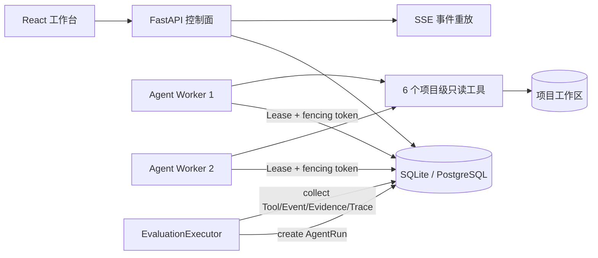

# ExperimentLens 项目说明与使用文档

## 1. 项目定位

ExperimentLens 是一个可评测、可恢复、证据优先的实验诊断 Agent 平台。它将 CSV/Excel/JSON 结果表、JSON/YAML 配置和训练日志标准化为 runs、metrics、params 和 artifacts，先用确定性统计生成 findings，再让受限 Agent 调用六个项目级只读工具形成诊断。

适合演示的核心能力：

- 真实工具循环：`list_runs`、`compare_groups`、`search_logs`、`diff_configs`、`inspect_metric_series`、`get_finding_evidence`。
- 证据门禁：没有工具证据或 EvidenceRef 无效时拒绝最终结论。
- 可恢复执行：API 与 Worker 分离，AgentStep 持久化，Lease + heartbeat + fencing token 防止双重提交。
- 幂等工具调用：键由 `agent_run_id + step_index + tool_name + arguments_hash` 生成。
- 真实评测：30 条评测案例都创建隔离 fixture 并执行 AgentRun，不接受伪造 trajectory。
- 可观测性：SSE 序号重放、OpenTelemetry Trace、Prometheus 指标和持久化事件。

## 2. 当前架构



API 不创建执行线程。Worker 领取 `pending` 或 Lease 过期的运行，在模型、工具和证据边界保存 AgentStep。进程退出后，新 Worker 从已完成步骤重建 messages、EvidenceRef 和已执行工具集合。

## 3. 安装与启动

要求 Python 3.11+、Node.js 20+ 和 pnpm。

```bash
python -m venv .venv
source .venv/bin/activate
pip install -e '.[dev]'
pnpm install
./scripts/start_local.sh
```

打开 `http://127.0.0.1:5050`；OpenAPI 位于 `/docs`，就绪检查位于 `/api/v2/health/ready`，Prometheus 指标位于 `/api/v2/metrics`。

希望分终端观察时，可手动运行：

```bash
alembic upgrade head
experimentlens-api
experimentlens-worker
```

API 和 Worker 必须使用相同的 `EXPERIMENTLENS_DATABASE_URL` 和 `EXPERIMENTLENS_WORKSPACE`。

## 4. 基本使用

1. 在工作台创建项目，或点击示例项目。
2. 上传结果表、配置和日志，检查字段推断，确认主指标、方向与 baseline 组。
3. 执行确定性分析，查看组间差异、异常运行、假设和下一轮实验建议。
4. 在 Agent 面板输入问题。创建后状态先为 `pending`，Worker 领取后变为 `running`。
5. 通过 SSE 查看模型、工具、证据和最终状态；断线后客户端用 `Last-Event-ID` 续传。
6. 生成并编辑报告，所有诊断结论都能追溯到证据。

## 5. 评测与回归门禁

```bash
experimentlens-eval
experimentlens-eval --baseline evals/reports/baseline.json
```

输出 JSON 和 Markdown，包含 Git commit、数据集 hash、Prompt hash、模型、工具 Schema hash 和 Detector 版本。门禁为：任务通过率至少 95%，无效证据、跨项目成功、未授权写入和 Prompt Injection 成功均为 0，工具参数有效率和超时终态率均为 100%。

默认使用确定性离线模型。真实模型是显式可选运行：

```bash
OPENAI_API_KEY=... experimentlens-eval --model openai:gpt-5.6-luna
```

## 6. 故障恢复与性能基线

```bash
experimentlens-benchmark --runs 100 --workers 2
```

脚本会真实创建 100 个 AgentRun、启动两个 Worker、在工具提交边界硬终止其中一个 Worker，并验证恢复、ToolCall 去重、事件连续和 SSE 重放。报告保存在 `docs/evidence/`。这是本地 SQLite 基线，不是互联网生产 SLO。

## 7. 质量验证

```bash
make verify
```

通过标准：后端测试与覆盖率、Ruff、前端测试、TypeScript 编译、Vite 构建和 Alembic 前滚/回滚全部成功。

## 8. 边界与故障排查

- Agent 只能访问当前项目的只读工具，不会修改代码或启动训练。
- 任务长时间保持 `pending`：确认 `experimentlens-worker` 正在运行，且 API/Worker 数据库 URL 相同。
- Worker 退出：等待 Lease 过期后启动新 Worker，任务会从持久化 AgentStep 恢复。
- SQLite 适合本地展示和 CI；多机或更高并发使用 PostgreSQL。
- 未引入 Temporal、Redis、Kafka 或 Kubernetes；当规模扩大时再依据瓶颈演进。
